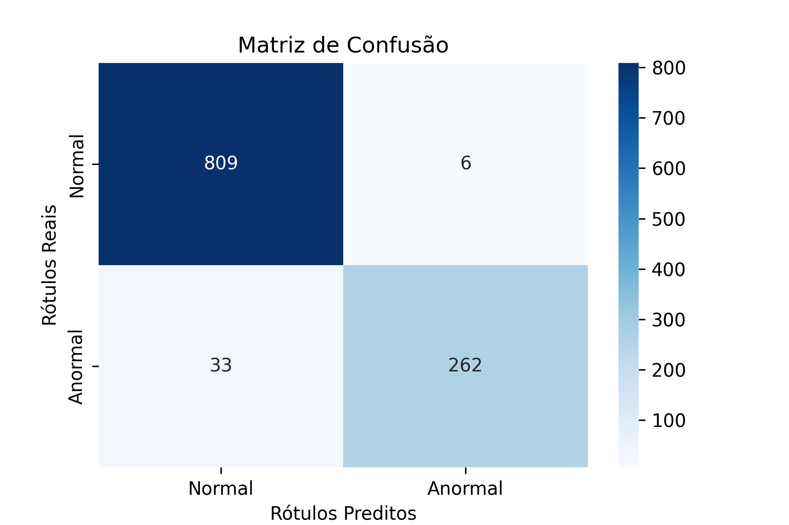
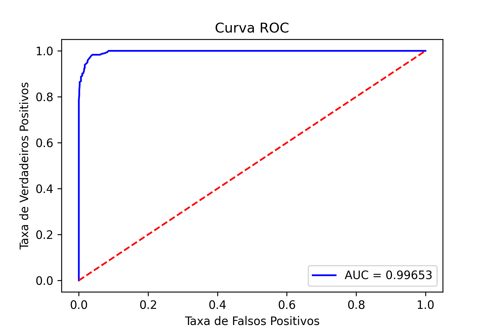

<div align="center">
  

  <br/><br/>

  <p align="center">
    <strong>Sistema Inteligente de Diagnóstico e Detecção de Falhas Acústicas em Ventiladores Industriais</strong><br/>
    Engenharia de IA e Processamento Digital de Sinais (DSP) aplicada à <strong>Manutenção Preditiva</strong> a partir do dataset <strong>MIMII</strong>.
  </p>
</div>

---

## 📌 1. Visão Geral da Arquitetura

O sistema processa sinais brutos de áudio (`.wav`) capturados em ambientes operacionais ruidosos, extrai coeficientes mel-espectrais (MFCCs) e emprega algoritmos de ensemble (*Random Forest*) para discriminar entre funcionamento normal e anômalo em ventiladores industriais:


---

## 📁 2. Estrutura do Repositório

```text
fan-audio-fault-detection/
├── assets/                  # Banners dinâmicos e identidades visuais do projeto
├── data/                    # Diretório estruturado para o dataset MIMII (áudios .wav)
│   └── fan/                 # Subpastas de IDs de equipamentos (id_00, id_02, etc.)
├── models/                  # Modelos serializados e persistidos pós-treinamento (.pkl)
├── src/
│   └── main.py              # Pipeline completo de extração de features, treino e avaliação
├── confusion_matrix.png     # Matriz de confusão da classificação de teste
├── roc_curve.png            # Curva ROC-AUC de discriminação acústica
├── requirements.txt         # Dependências do ecossistema Python (Librosa, Sklearn)
└── README.md                # Documentação técnica e guia de execução
```

---

## ⚙️ 3. Configuração do Ambiente

### Pré-requisitos
- Python 3.9+
- Git

### Instalação

```bash
# 1. Clone o repositório
git clone https://github.com/lucenfort/fan-audio-fault-detection.git
cd fan-audio-fault-detection

# 2. Crie e ative o ambiente virtual
python3 -m venv .venv
source .venv/bin/activate  # Linux/macOS
# .venv\Scripts\activate   # Windows

# 3. Instale as dependências
pip install --upgrade pip
pip install -r requirements.txt
```

---

## 🚀 4. Execução dos Componentes

### 4.1 Preparação dos Dados
Baixe o conjunto de dados [MIMII Dataset (Fan Subset)](https://zenodo.org/record/3384388) e estruture os arquivos de áudio dentro da pasta `data/`:

```text
data/fan/
├── id_00/
│   ├── normal/    # Arquivos .wav em operação padrão
│   └── abnormal/  # Arquivos .wav com defeitos mecânicos
└── ...
```

### 4.2 Execução do Pipeline de Treinamento e Avaliação
```bash
python3 src/main.py
```

O script executará a extração dos coeficientes MFCCs via `librosa`, dividirá a base em treino/teste estratificado, treinará o modelo Random Forest e gerará os gráficos de desempenho automaticamente.

---

## 📊 5. Principais Resultados & Métricas

Após validação cruzada e avaliação sobre o conjunto de teste de anomalias acústicas, o pipeline alcançou alta robustez:

- **Acurácia Global de Classificação:** `96.49%`
- **Área sob a Curva ROC (AUC-ROC):** `0.9965`
- **Sensibilidade a Anomalias (Recall):** Superior a `95%` sob ruído de fundo industrial.

<div align="center">
  
  
</div>

---

## 📜 Créditos & Conjunto de Dados

O conjunto de dados de áudio industrial utilizado neste projeto é proveniente do consórcio **MIMII**:
- **Dataset:** *MIMII Dataset: Sound Dataset for Malfunctioning Industrial Machine Investigation and Inspection*
- **Publicação:** Purohit et al., DCASE 2019 / arXiv:1909.09347.
- **Licença:** [Creative Commons Attribution 4.0 International](https://creativecommons.org/licenses/by/4.0/).
